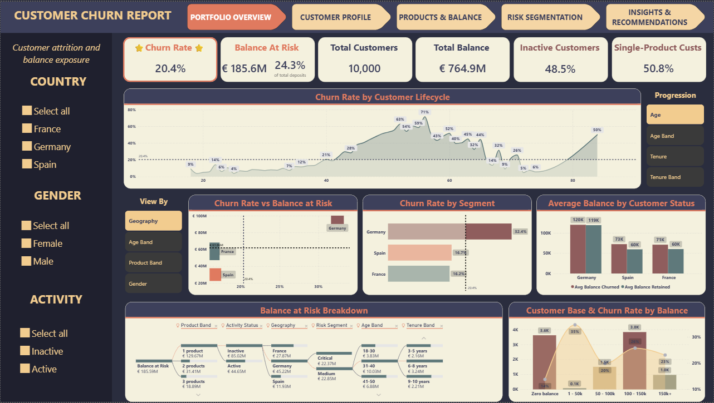
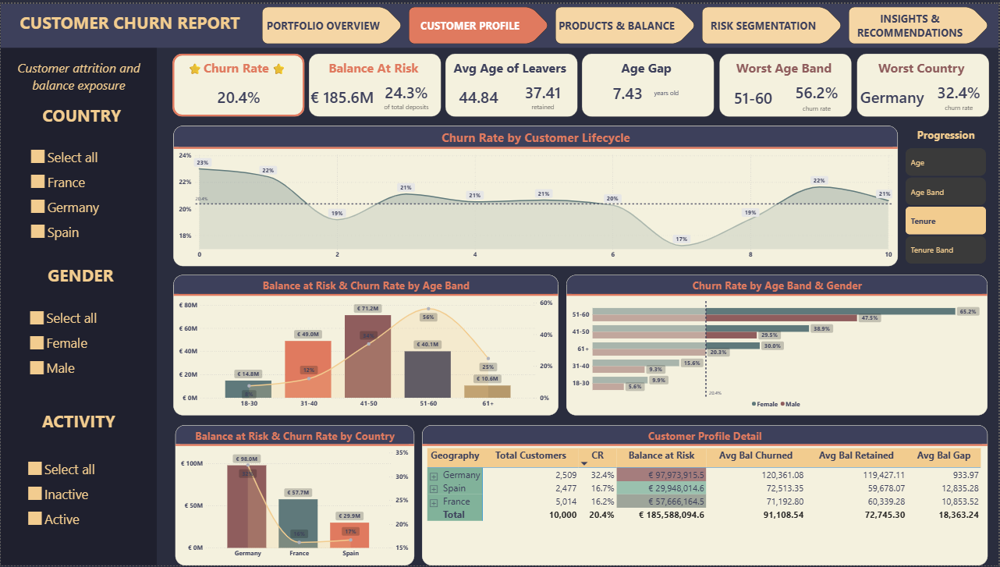
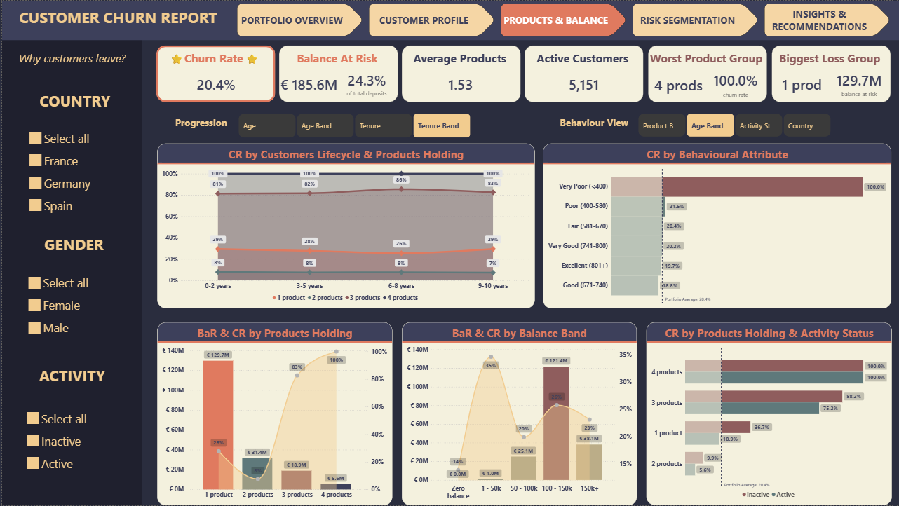
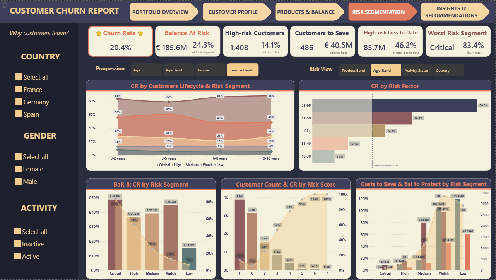
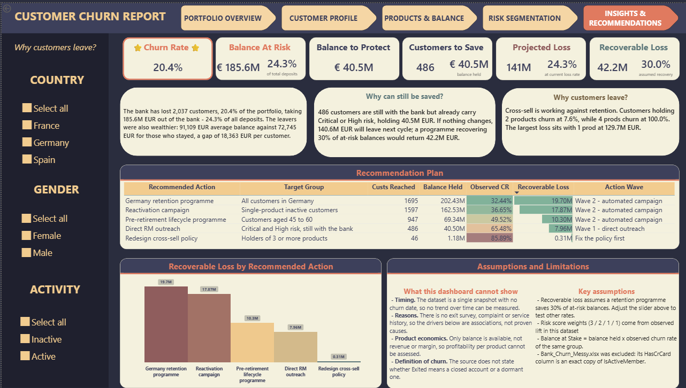
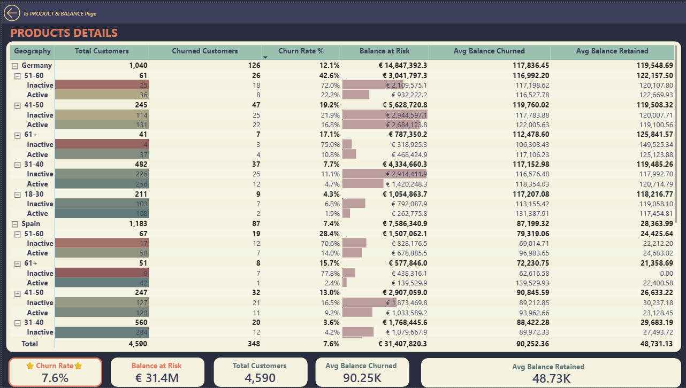
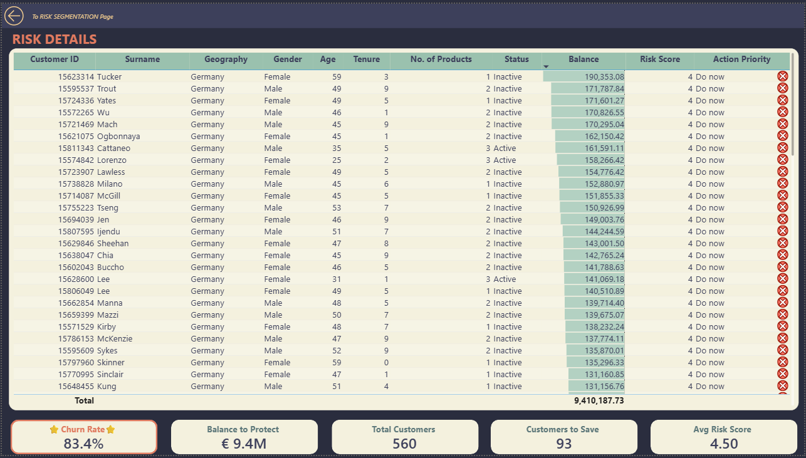

# Bank Customer Churn Analytics — Turning Attrition into a Call List

A Power BI report for the retail division of a European bank that converts customer churn from a headcount percentage into **euros at risk**, scores which customers are about to leave, and ends with a ranked retention plan the team can act on the same week.

|  |  |
|---|---|
| **Tools** | Power BI (Power Query, DAX, data modelling), Design Thinking |
| **Dataset** | Retail bank customer snapshot — France, Germany, Spain |
| **Period analysed** | Single snapshot, no date column — customer lifecycle used as the time axis |
| **Records** | 10,000 customers · 2,037 churned · €764.9M total deposits |
| **Model** | Star schema · 1 fact + 9 dimensions + 4 field parameters + 2 helper tables · 68 measures |
| **File** | [`Bank_Customer_Churn.pbix`](Bank_Customer_Churn.pbix) |

---

## Key takeaways

- **One in five customers left, but they took one in four euros.** Churn is **20.4%** by headcount and **24.3%** by balance — leavers held **€91,109** on average against **€72,745** for those who stayed. The bank is not losing customers; it is losing the wealthy ones.
- **Cross-sell has a stopping point, and the bank is past it.** Churn bottoms out at **7.6% on two products**, then climbs to **82.7% on three** and **100% on four**. Yet the money is lost at the other end: single-product customers account for **€129.7M** of the €185.6M at risk.
- **14.1% of customers carry 46.2% of the loss.** A four-factor risk score concentrates the retention budget — every euro spent on this group works **3.3× harder** than spreading it evenly.
- **Only 93 Critical-risk customers are still with the bank, and 78 of them are in Germany.** A list that size is one relationship manager for one week — no campaign, no marketing budget.
- **€140.6M will walk next cycle if nothing changes.** A retention programme recovering 30% of at-risk balances returns **€42.2M**.

---

## Table of contents

1. [Business context](#1-business-context)
2. [Dataset](#2-dataset)
3. [Data preparation](#3-data-preparation)
4. [Data model](#4-data-model)
5. [Dashboard](#5-dashboard)
6. [Analysis and insights](#6-analysis-and-insights)
7. [Conclusion and recommendations](#7-conclusion-and-recommendations)
8. [Approach](#8-approach)

---

## 1. Business context

The bank serves 10,000 retail customers across France, Germany and Spain. The problem is not that churn is unknown — it is that **churn is reported as a percentage of people, and budgets are approved in euros.**

Every month the retention report says "churn is 20%". Nobody can answer the next three questions: how much money walked out with those customers, which of the people still here are about to follow them, and where a limited retention budget buys the most. The gap between a headcount metric and a currency decision is where the report lives.

The primary viewer is the **Head of Retail Banking**, who owns deposit balances and the retention target, reviewing monthly ahead of budget allocation. The report answers five questions in sequence — one per page:

| | Question | Why it comes in this order |
|---|---|---|
| **Q1** | How many customers left, and how much money went with them? | Without the scale you cannot set a target |
| **Q2** | Who is leaving? | A profile is what lets you define a group |
| **Q3** | Why are they leaving? | A cause is what tells you where to intervene |
| **Q4** | Who is **about to** leave? | The first three describe the past. Only this one can be acted on |
| **Q5** | So what do we do? | A quantified plan, in a form a budget committee can approve |

---

## 2. Dataset

| Table | Rows | Role | Key fields |
|---|---|---|---|
| `Fact_Customer` | 10,000 | Fact — one row per customer | customer ID, credit score, age, tenure, balance, products, active flag, **churn flag**, plus 10 columns built in Power Query |
| `Dim_Geography` | 3 | Dimension — market | France, Germany, Spain |
| `Dim_Gender` | 2 | Dimension — gender | |
| `Dim_ActivityStatus` | 2 | Dimension — engagement | active / inactive |
| `Dim_AgeBand` | 5 | Dimension — age bracket | 18-30 … 61+ |
| `Dim_TenureBand` | 4 | Dimension — relationship length | 0-2 … 9-10 years |
| `Dim_BalanceBand` | 5 | Dimension — deposit bracket | zero balance … 150k+ |
| `Dim_ProductBand` | 4 | Dimension — products held | 1 … 4 products |
| `Dim_CreditBand` | 6 | Dimension — credit score bracket | **very poor (<400)** … excellent (801+) |
| `Dim_RiskSegment` | 5 | Dimension — risk tier | Critical · High · Medium · Watch · Low |
| `Dim_Action` | 5 | Helper (DAX) — recommended actions | action, target group, lever |
| `Recovery Rate` | 13 | Helper (DAX) — what-if | 0% … 60% in 5-point steps |

Plus four **field parameters** — `Progression`, `Customer Dimension`, `Behaviour View`, `Risk View` — that let one visual serve several viewpoints, keeping every page under seven charts.

The grain is one row per customer. There is no transaction table and no date column; both constraints shaped the design and are documented below.

---

## 3. Data preparation

### 3.1 Two source files, and one of them has a corrupted column

**Problem.** The dataset ships as two files: a clean `Bank_Churn.csv` and an unprocessed `Bank_Churn_Messy.xlsx` split across two sheets. The instinct is to use the messy one — cleaning data is the analyst's job. I profiled it and found seven issues:

| # | Issue | Fixable in Power Query? |
|---|---|---|
| 1 | Data split across two sheets, 10,001 and 10,002 rows | Yes — merge on customer ID |
| 2 | **Three countries stored as five values**: Germany · Spain · France · French · FRA | Yes — consolidate |
| 3 | Money stored as text with a currency symbol: `€101348.88` | Yes — strip and retype |
| 4 | `Yes`/`No` instead of `1`/`0` on two boolean columns | Yes |
| 5 | Duplicate customer IDs — 1 pair in one sheet, 2 in the other | Yes — remove duplicates |
| 6 | Nulls: 3 surnames, 3 ages | Yes |
| 7 | **`HasCrCard` is a byte-for-byte copy of `IsActiveMember`** | **No** |

**The seventh is why the file was abandoned.** The credit-card column matches the activity column on **10,002 of 10,002 rows**, including the distribution — 5,152 `Yes` and 4,850 `No` on both. It is not credit-card data; it is the activity column written twice.

Used as-is, it produces a clean and completely false finding:

| | No card | Has card | Conclusion |
|---|---|---|---|
| Messy file | 26.9% | 14.3% | *"Issuing a card halves churn"* |
| Clean file | 20.8% | 20.2% | **Credit cards have no effect** |

The 14.3% is measuring engagement, not card ownership. Cleaning cannot recover information that was overwritten at source, so the report uses **one source only: `Bank_Churn.csv`.** That trades away a chance to demonstrate data-cleaning technique in exchange for conclusions that hold.

### 3.2 No date column — lifecycle as the time axis

**Problem.** The dataset is a single snapshot. There is no churn date, no transaction history, no way to draw a trend line.

**Fix.** Rather than drop the idea of progression, the report substitutes **customer lifecycle for calendar time** through a `Progression` field parameter that switches the axis between `Age`, `Age Band`, `Tenure` and `Tenure Band`. Every page carries one chart on this parameter, so each page can still ask "does this effect change as the relationship matures?"

This turned out to carry a finding of its own — see [6.3](#63-age-not-tenure--and-the-peak-is-pre-retirement). The limitation is stated on the report itself: when a `SnapshotDate` column eventually arrives, these visuals become real trend charts without a redesign.

### 3.3 A risk score built from observed lift, not intuition

Four columns are added to the fact table in Power Query, each scoring one churn driver. The weights are not judgement calls — they are the measured lift of each factor against the 20.37% portfolio baseline:

| Factor | Churn in group | Lift | Points |
|---|---|---|---|
| Holds 3+ products | 85.9% | **4.22×** | **3** |
| Aged 45-60 | 49.5% | **2.43×** | **2** |
| Lives in Germany | 32.4% | **1.59×** | **1** |
| Inactive member | 26.9% | **1.32×** | **1** |

Summing gives a 0-7 score, bucketed into five segments. The score validates cleanly: churn climbs **6.5% → 13.3% → 25.2% → 53.7% → 77.8% → 93.4% → 100% → 100%** across the eight rungs without a single reversal. Each additional point roughly doubles the probability of leaving.

### 3.4 A column that is not data

`EstimatedSalary` was tested and excluded. Four checks all point the same way:

- Kolmogorov–Smirnov against a uniform distribution: **p = 0.841** — the hypothesis that this is a uniform random variable cannot be rejected
- Skew **0.002**, kurtosis **−1.182** (a theoretical uniform distribution is −1.2); real salaries are right-skewed
- Correlation with account balance: **+0.013** — in a real bank these are strongly related
- Churn across salary quintiles: 20.0 · 20.0 · 20.0 · 20.2 · 21.6 — flat, and the difference between leavers and stayers is €1,727 at **p = 0.226**

Split into ten equal bands from 0 to 200k, each band holds almost exactly 1,000 customers. The column was generated at random when the dataset was created, so it is recorded as a **data-quality finding rather than an analytical dimension**.

---

## 4. Data model

A star schema — one fact table at customer grain, nine conformed dimensions, all relationships many-to-one and single-direction:

```
                        Dim_Geography   Dim_Gender   Dim_ActivityStatus
                                 \          |          /
   Dim_AgeBand ----------         \         |         /         ---------- Dim_TenureBand
                         \         \        |        /         /
   Dim_BalanceBand ------- ------  Fact_Customer  ------ ------- Dim_ProductBand
                         /                 |                 \
   Dim_CreditBand -------                  |                  ------- Dim_RiskSegment
                                   (10,000 customers)

   Disconnected:  Progression · Customer Dimension · Behaviour View · Risk View
                  Dim_Action · Recovery Rate
```

**Measure groups (68 total)** — organised by what the calculation *is*, not by which page uses it, so a measure is written once and reused everywhere:

| Group | Examples | Purpose |
|---|---|---|
| 01 Base | Total Customers, Churned, Retained, Total Balance | Raw counts and sums |
| 02 Northstar 1 | **Churn Rate %**, Retention Rate %, Portfolio Churn Rate % | Retention quality |
| 03 Northstar 2 | **Balance at Risk**, Balance at Risk %, Share % | Loss measured in euros |
| 04 Churned vs retained | Avg Balance / Avg Age churned · retained · gap | The wealth and age gap |
| 05 Guardrails | Active %, Inactive %, Avg Products, Single Product % | Early-warning indicators |
| 06 Risk and priority | Priority Customers, Addressable Loss, Customers to Save, Projected Loss | Forward-looking |
| 07 Score composition | Score from Products / Age / Inactive / Germany | Explains the risk score |
| 08 Dynamic labels | Worst Age Band · Geography · Product Group · Risk Segment | Self-updating "worst group" cards |
| 09 Insight text | Insight 1 Scale · 2 Product · 3 Action | Written conclusions, generated |
| 10 Recommendation table | Customers Reached, Balance Held, Balance at Stake, Action Wave | Drives the action plan |

**Two Northstars, on purpose.** Churn Rate % alone misleads: the 4-product group churns at 100% but holds only €5.6M, while the 1-product group churns at 27.7% and holds €129.7M. Ranking by rate and ranking by money produce different answers almost everywhere in this dataset, so both sit side by side on every page.

**Written conclusions are generated, not typed.** Every number in the three insight blocks on the final page comes from DAX, so the prose can never drift from the model when a filter is applied:

```dax
Insight 3 Action =
FORMAT ( [Customers to Save], "#,0" )
    & " customers are still with the bank but already carry Critical or High risk, holding "
    & FORMAT ( [Balance to Protect], "#,0,,.0" ) & "M EUR. If nothing changes, "
    & FORMAT ( [Projected Loss], "#,0,,.0" ) & "M EUR will leave next cycle; a programme recovering "
    & FORMAT ( [Recovery Rate Value], "0%" ) & " of at-risk balances would return "
    & FORMAT ( [Recoverable Loss], "#,0,,.0" ) & "M EUR."
```

**The projection uses the balance-weighted rate, not the headcount rate.** This is a direct consequence of the report's own headline finding — because leavers are wealthier, applying the 20.37% headcount rate to a pool of money understates the loss by €22M:

```dax
Projected Loss = [Retained Balance] * [Balance at Risk %]     --  579.3M x 24.26%  =  140.6M
```

**The recommendation table is a disconnected DAX table.** `Dim_Action` holds five actions; a `SWITCH` on its key computes each row's reach, balance and recoverable loss against the fact table. No relationship — the table must stay disconnected or every figure in it breaks.

---

## 5. Dashboard

Seven pages across three tiers: **Overview** (leadership, 30-second read) → **Analysis** (3 pages, diagnosis) → **Detail** (2 hidden pages, reached by **drill-through** for record-level lookup) → **Conclusion**.

Every page follows the same grid: a fixed slicer rail on the left, six scorecards, then charts grouped into bands — with each field parameter placed at the head of the band it controls, so the reader can see which control drives which charts without experimenting.

### Portfolio Overview — *how much are we losing?*



### Customer Profile — *who is leaving?*



### Products & Balance — *why are they leaving?*



### Risk Segmentation — *who is about to leave?*



### Insights & Recommendations — *what do we do next?*



### Drill-through to record level

The two heaviest analysis pages hand off to hidden detail pages. Right-clicking a product group or a risk segment opens a full-screen page already filtered to that selection, so a manager who spots a problem can reach the underlying rows without leaving the report.

- **Products Detail** (from Products & Balance) — a matrix drilling Country → Age Band → Activity, with six measures per cell.
- **Risk Detail** (from Risk Segmentation) — a flat, exportable customer list filtered to **customers who are still with the bank**, sorted by balance descending. This is the call list: right-click *Critical*, export, and the retention team has 93 names ranked by what is at stake.

 

Both pages are hidden from the navigation bar and reachable only by drilling, which keeps the leadership view clean while putting a record-level lookup one click away.

---

## 6. Analysis and insights

### 6.1 The bank is losing its wealthiest customers

Churn is **20.37%** by headcount but **24.26%** by balance. The gap is not rounding — leavers held **€91,109** on average against **€72,745** for customers who stayed, a difference of **€18,363 per head**.

**Insight.** This single fact reframes the whole problem. A headcount metric treats all churn as equal; the two rates differ by four percentage points precisely because attrition is selecting for wealth. Every downstream calculation in the report uses the balance-weighted rate as a result — including the forward projection, where using the headcount rate instead would understate next cycle's loss by **€22M**.

### 6.2 Cross-sell has a stopping point, and it is at two products

| Products | Customers | Churn | Balance at risk |
|---|---|---|---|
| 1 | 5,084 | 27.7% | **€129.7M** |
| **2** | 4,590 | **7.6%** | €31.4M |
| 3 | 266 | 82.7% | €18.9M |
| **4** | 60 | **100%** | €5.6M |

Churn falls almost fourfold from one product to two — exactly as cross-sell theory predicts — then reverses violently. Sixty customers hold four products and **every single one of them has left.**

**Insight.** The bank's own growth strategy turns against it past the second product. But the column and the line point in opposite directions: the 100%-churn group costs only €5.6M because it is tiny, while the group with the *second-lowest* churn rate costs €129.7M because it is 85× larger. Ranking by rate would send the entire budget to sixty people.

The small-sample caveat is shown on the dashboard rather than hidden — customer count sits in the tooltip of every visual with a group under 300.

**And the fix is already measurable.** Reactivating a dormant single-product customer cuts churn from **36.7% to 18.9%** — the strongest available intervention, landing on the group that holds the most money. The exception is the four-product group, where churn is 100% whether active or not; activation cannot save it, which is why the recommendation there is a policy change rather than a campaign.

### 6.3 Age, not tenure — and the peak is pre-retirement

Tenure is flat. Across four bands from 0-2 to 9-10 years, churn moves between **18.9% and 21.3%** — a spread of 2.4 points, with the portfolio average running straight through the middle. Ten years of relationship buys the bank nothing.

Age is the opposite. Churn climbs from **7.5%** in the 18-30 band to **56.2%** at 51-60 — a factor of 7.5 — then **falls back to 24.8%** after 60.

**Insight.** The drop after 60 is the part that matters. If churn simply rose with age, the story would be demographic drift. The inverted-U says something more specific: the risk concentrates in the years **immediately before retirement**, when customers consolidate accounts and move money. That is a life-stage trigger with a predictable window, not a slow decay — and a flat tenure line is itself a finding, so it is kept on the page with the y-axis locked to prevent a 2.4-point spread from being rendered as a hill.

Gender compounds it. Women churn more than men in **every** age band without exception, and the gap widens with age: +4.3, +6.3, +9.4, **+17.7**, +9.7 points. Women aged 51-60 churn at **65.2%** — the highest cell in the entire demographic matrix.

### 6.4 Germany is real, not a composition artefact

Germany churns at **32.4%**, roughly double France at 16.2%, and loses **€98.0M** — more than the other two markets combined.

The obvious objection is that German customers are simply wealthier, and wealthier customers move banks more. Germany is also the **only market with no zero-balance customers at all** (France 48.2%, Spain 48.4%), and zero-balance customers churn least — so the headline number could be pure composition.

Recomputing on customers with a positive balance only: Germany **32.4%**, France **18.2%**. The gap survives.

**Insight.** The effect is real, and the detail matrix shows what kind of problem it is. In France and Spain the balance gap between leavers and stayers is positive in every age band — attrition selects for wealth. In Germany it is near zero, and **negative in the 51-60 band**. German churn does not discriminate by wealth, which makes it a market-wide problem rather than a high-value-customer problem — and that is why the recommendation for Germany is a market programme rather than a targeted one.

### 6.5 A seventh of the customers carry half the loss

The four-factor risk score sorts the book cleanly: **83.4% → 53.7% → 25.2% → 13.3% → 6.5%** across the five segments, monotone and well separated, and the ranking holds across the entire customer lifecycle without the bands ever crossing.

**14.08% of customers** — the Critical and High segments — account for **46.2%** of all balance lost. A euro of retention budget aimed at this group works **3.3× harder** than one spread evenly.

**Insight, and a trap.** The churn line falls beautifully, but the money columns do not: €48.9M · €36.8M · €39.3M · €45.2M across the top four segments — almost level. The Watch segment churns at only 13.3% yet still loses €45.2M, because it is seven times larger than Critical. Ranking by rate alone would send everything to 560 people and ignore 3,878 who are quietly losing the same amount. The plan therefore splits into two lanes: **direct outreach for Critical and High, automated campaigns for Watch.**

**The number that makes it operational.** The Critical segment has 560 customers — but **467 have already gone.** Ninety-three remain, holding €9.41M, averaging €101,000 each, the highest of any segment. Seventy-eight of those ninety-three are in Germany.

Ninety-three is a list one relationship manager clears in a week. No campaign, no marketing budget — just a list, which the drill-through page exports directly.

### 6.6 Credit score says nothing — except at the very bottom

Across the main bands, credit score is flat and non-monotone: 21.5% · 20.4% · 18.8% · 20.3% · 19.7%. A 3.3-point spread with the best-scoring band not even at the bottom. It interacts with nothing — activity, country, age, products all show the same flat rows.

Then there is the tail. **Nineteen customers score below 400, and all nineteen have left** — probability under chance 7.4 × 10⁻¹⁴.

**Insight.** Six of those nineteen were rated Low or Watch by the risk score — the model put them in its safest buckets, and every one of them left anyway. The standard banding hid this completely: nineteen customers diluted into a 2,393-strong "Poor" bucket read as 22.1%, which looks like nothing.

The conclusion is deliberately narrow: credit score does **not** predict churn across 99.8% of the book, but below 400 it predicts it with certainty. A `Very Poor (<400)` band was added so the effect is visible, and because no such customer remains today, it is recorded as a **monitoring rule for the next refresh** rather than a fifth factor in the score. Adding it would change no number on the current dashboard while complicating a model that is working.

---

## 7. Conclusion and recommendations

**What the data says.** The bank is losing its wealthier customers, its cross-sell strategy reverses past two products, risk concentrates in a seventh of the book, and €140.6M is on track to leave next cycle. Five actions follow, each sized from the model:

| Priority | Action | Customers | Recoverable | Lane |
|---|---|---|---|---|
| 1 | **Germany retention programme** | 1,695 | **€19.7M** | Automated campaign |
| 2 | **Reactivate dormant single-product customers** | 1,597 | **€17.9M** | Automated campaign |
| 3 | **Pre-retirement programme, ages 45-60** | 947 | €10.3M | Automated campaign |
| 4 | **Direct RM outreach to Critical + High** | **486** | €8.0M | Manual calls |
| 5 | **Redesign the cross-sell policy** | 46 | €0.3M | Policy change |

Three things the ranking shows that are easy to get wrong:

- **It is counter-intuitive, and correctly so.** The action targeting the most dangerous group — 65.5% churn — ranks *fourth*, because that group is small. Germany leads on half the churn rate simply by being three times larger and wealthier. Scale multiplied by rate is what produces money.
- **The rows cannot be added up.** A 52-year-old inactive German customer appears in four of them. The first three overlap down to **3,575 unique people**, not 4,239 — which is why the table ships with totals switched off.
- **The smallest action is ranked high anyway.** Redesigning cross-sell recovers only €0.3M because just 46 qualifying customers remain. But the other four treat symptoms while this one closes the source: leave the policy alone and the bank manufactures a fresh cohort at 82-100% churn every quarter. The €0.3M measures what can be saved today, not the damage that never happens.

**Limitations.**

- **No time axis.** A single snapshot with no churn date — nothing here is a trend. Lifecycle stands in for calendar time, and the design converts to real trend charts the moment a `SnapshotDate` column exists.
- **Correlation, not causation.** No exit survey, no complaint log, no service history. Every driver identified is an association.
- **No margin data.** Balance is available; revenue and profit per product are not, so product profitability cannot be assessed.
- **The risk weights come from this dataset.** They are observed lift, rounded to integers for business readability — not a trained, validated model.
- **The 30% recovery rate is an assumption, not a forecast.** It is exposed as a what-if parameter and stated on the page.
- **One column was discarded as synthetic** (`EstimatedSalary`) and **one source file was discarded as corrupted** (`Bank_Churn_Messy.xlsx`); both decisions are documented in section 3.

---

## 8. Approach

Built with a **Design Thinking** process — Empathise → Define POV → Ideate → Prototype → Review — documented in [`Design_Thinking.xlsx`](Design_Thinking.xlsx). Four decisions from that process shaped the report:

- **Two Northstar metrics instead of one.** Churn Rate % is the industry standard and normalises across group sizes; Balance at Risk is what a budget committee can act on. Because they rank groups differently almost everywhere in this dataset, dropping either one produces a wrong priority list.
- **Lifecycle in place of calendar time.** Rather than abandon the idea of progression on a dateless dataset, a field parameter swaps the axis between age and tenure — which is what surfaced both the flat tenure line and the pre-retirement peak.
- **Keeping the dimensions that show nothing.** Tenure, credit score and credit-card ownership are all on the report despite carrying no signal, because each one refutes a belief the business holds. A dimension that disproves an assumption earns its place.
- **Seven pages in three tiers.** Leadership overview, analyst diagnosis, and operational lookup serve different readers and different questions; collapsing them into one dense page would serve none of them well.

---

*Sample data for a European retail bank. Every figure in this README reconciles to the published `.pbix` model.*
